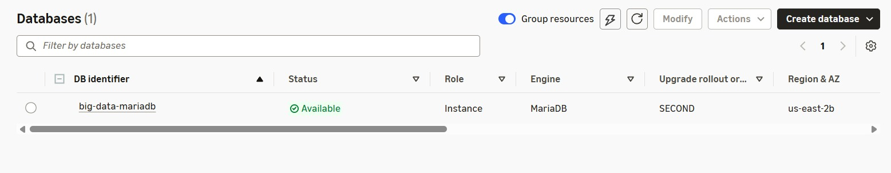
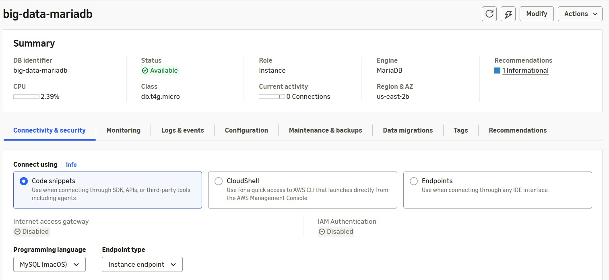
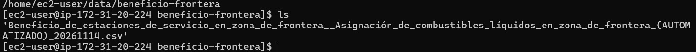
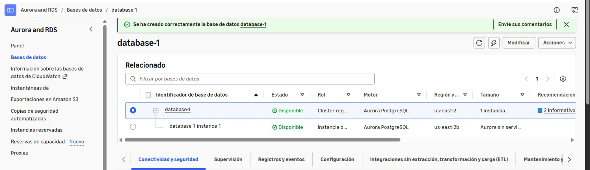

# Punto 2: Fuentes de Datos y Asignación de Infraestructura

Para cumplir con el requerimiento de simulación de fuentes heterogéneas exigido en el proyecto (Base de datos relacional RDS, archivos planos en servidor Linux EC2 y fuentes Web vía API/URL), se integran y mapean los 7 datasets del sector energético colombiano de la siguiente manera:

---

## 1. Mapeo y Justificación Técnica de Fuentes

| Dataset | Enlace Oficial / Fuente | Filas Reales | Componente AWS | Formato y Justificación Técnica |
| --- | --- | --- | --- | --- |
| **Distribuidores Mayoristas - Despacho** | [datos.gov.co (339g-zjac)](https://www.datos.gov.co/Minas-y-Energ-a/Distribuidores-Mayoristas-Despacho-de-combustibles/339g-zjac/about_data) | **7.18M** | **URL / API** | **Socrata API (JSON paginado)**: Dataset masivo de hechos. Se extrae vía HTTP directo al Data Lake (S3 Raw) en fragmentos para procesamiento distribuido. |
| **Estaciones de Servicio Automotriz y Fluvial** | [datos.gov.co (fbht-2fzd)](https://www.datos.gov.co/Minas-y-Energ-a/Estaciones-de-Servicio-Automotriz-y-Fluvial-Despac/fbht-2fzd/about_data) | **6.48M** | **URL / API** | **Socrata API (JSON paginado)**: Registros transaccionales masivos de estaciones de servicio descargados dinámicamente mediante paginación offset/limit. |
| **IEA Monthly Electricity Statistics** | [Kaggle (ccanb23)](https://www.kaggle.com/datasets/ccanb23/iea-monthly-electricity-statistics) | **180K** | **Instancia EC2** | **CSV local en EC2 (`file_zip.csv`)**: Datos internacionales descargados en `/home/ec2-user/data/iea-monthly-electricity-statistics/` para ingesta por lotes hacia S3 vía SSM/CLI. |
| **Ventas de GNCV** | [datos.gov.co (v8jr-kywh)](https://www.datos.gov.co/Minas-y-Energ-a/Consulta-Ventas-de-Gas-Natural-Comprimido-Vehicula/v8jr-kywh/about_data) | **135K** | **Instancia EC2** | **CSV plano local**: Simula reportes operativos exportados en el almacenamiento local de un servidor Linux (`/home/ec2-user/data/ventas-gncv/`). |
| **Beneficio Zona de Frontera** | [datos.gov.co (shbt-hqy9)](https://www.datos.gov.co/Minas-y-Energ-a/Beneficio-de-estaciones-de-servicio-en-zona-de-fro/shbt-hqy9/data_preview) | **90.4K** | **Instancia EC2** | **CSV plano local**: Archivo de volumen medio almacenado en EC2 para transferencia por lotes hacia S3. |
| **Productores B100 y Etanol** | [datos.gov.co (macx-96u2)](https://www.datos.gov.co/Minas-y-Energ-a/Productores-Productores-de-B100-y-Etanol-Alcohol-C/macx-96u2/about_data) | **47K** | **RDS MariaDB** | **Tabla SQL OLTP (`productores`)**: Catálogo relacional con tipos de datos estructurados e integridad referencial poblado en base de datos transaccional. |
| **Agentes GNCV** | [datos.gov.co (ba2i-v4xx)](https://www.datos.gov.co/Minas-y-Energ-a/Consulta-Agentes-de-Gas-Natural-Comprimido-Vehicul/ba2i-v4xx/data_preview) | **1,761** | **RDS MariaDB** | **Tabla SQL OLTP (`agentes_gncv`)**: Dimensión relacional estructurada consultada y extraída hacia S3 Raw. |

---

## 2. Evidencias de Infraestructura de Fuentes

Las siguientes capturas documentan el aprovisionamiento de las tres fuentes heterogéneas en AWS:

### 1. Base de Datos RDS MariaDB Aprovisionada
Instancia de base de datos relacional `big-data-mariadb` en estado `Disponible` en AWS RDS (región `us-east-2b`):

### 2. Configuración y Conectividad de MariaDB en RDS
Detalle de clase de instancia (`db.t4g.micro`), motor MariaDB y endpoint de conexión:

### 3. Almacenamiento Local de Archivos en Servidor EC2 Linux
Terminal conectada a la instancia EC2 (`ec2-user@ip-172-31-20-224`) listando los archivos CSV en `/home/ec2-user/data/beneficio-frontera/`:

### 4. Clúster de Base de Datos Relacional Adicional
Aprovisionamiento de base de datos relacional `database-1` en estado disponible:

