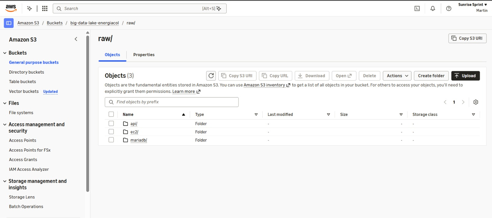
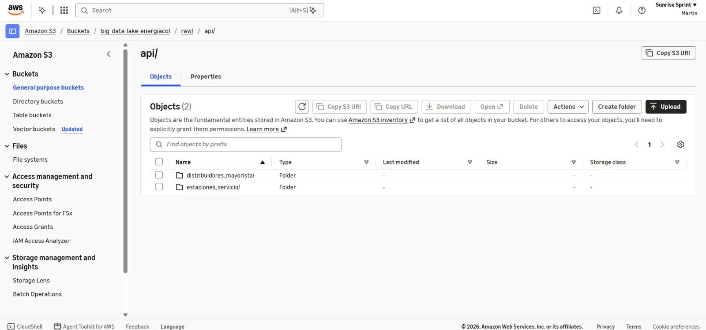
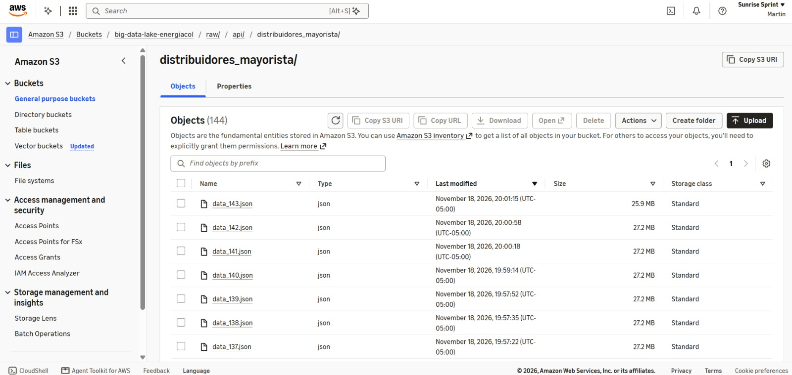
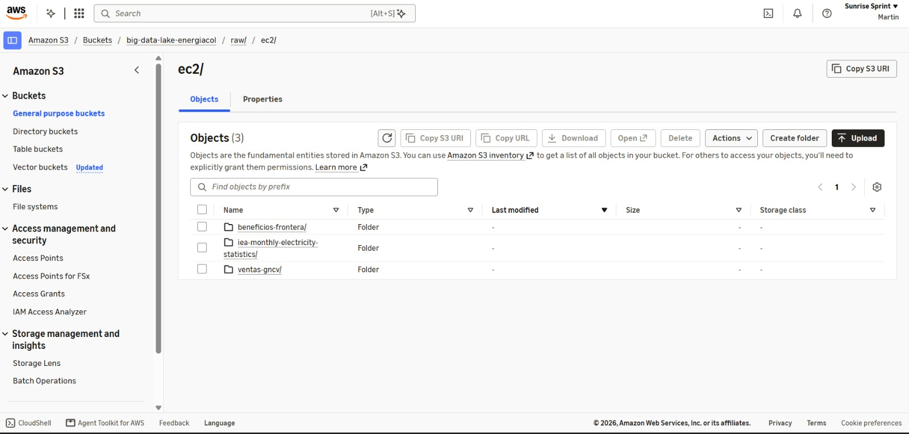
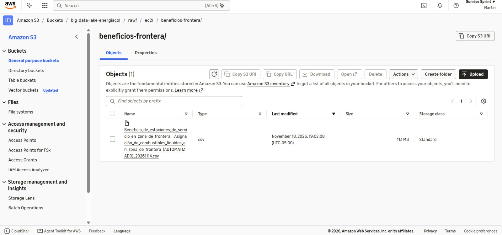
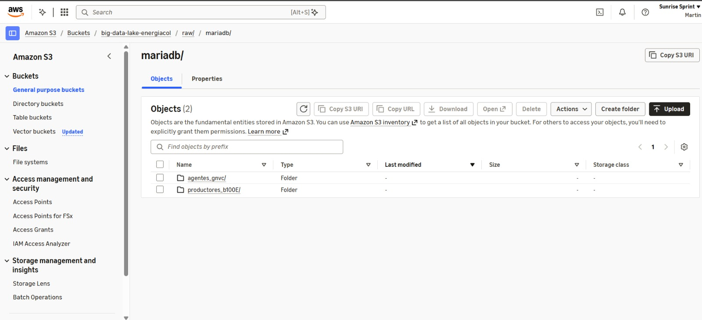
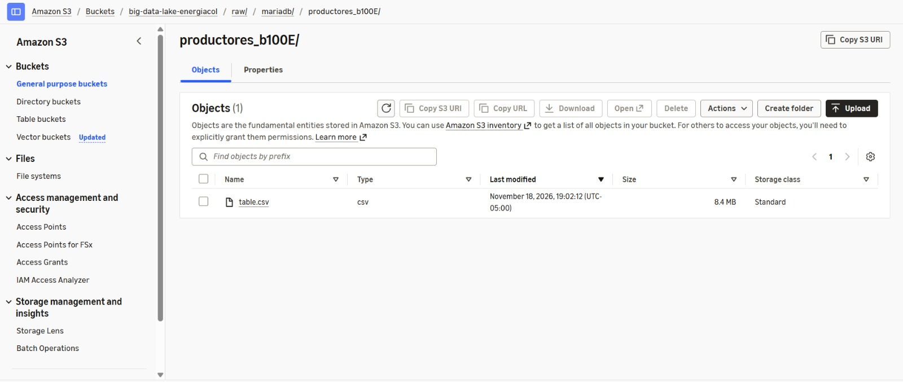

# Punto 3: Ingesta hacia Amazon S3 (Capa Raw / Bronze)

Este módulo implementa el proceso de **ingesta automática de datos** hacia el Data Lakehouse en Amazon S3.
Extrae información desde las tres fuentes heterogéneas simuladas (Base de datos relacional RDS MariaDB, servidor Linux EC2 y APIs públicas de datos abiertos) y la deposita de manera inmutable y estructurada en la zona **Raw (Bronze)** del bucket `big-data-lake-energiacol`.

---

## 1. Bucket Principal y Scripts de Ingesta

**Bucket en Amazon S3:** `s3://big-data-lake-energiacol/`

| Script de Ingesta | Fuente de Datos Origen | Destino en S3 | Formato Almacenado |
|---|---|---|---|
| `ingest_rds.py` | AWS RDS MariaDB | `s3://.../raw/mariadb/` | CSV estructurado (`table.csv`) |
| `ingest_ec2.py` | Instancia Linux EC2 | `s3://.../raw/ec2/` | CSV sin procesar |
| `ingest_api.py` | API Abierta (datos.gov.co) | `s3://.../raw/api/` | Lotes JSON paginados (`data_N.json`) |

---

## 2. Estructura de Carpetas en la Capa Raw de S3

```
s3://big-data-lake-energiacol/
└── raw/
    ├── ec2/
    │   ├── beneficios-frontera/                 <- CSV (~90K filas)
    │   ├── ventas-gncv/                         <- CSV (~135K filas)
    │   └── iea-monthly-electricity-statistics/  <- file_zip.csv (~180K filas)
    │
    ├── mariadb/
    │   ├── productores_b100E/                   <- table.csv (~47K filas)
    │   └── agentes_gnvc/                        <- table.csv (~1,761 filas)
    │
    └── api/
        ├── distribuidores_mayorista/            <- data_0.json ... data_143.json (~7.18M filas)
        └── estaciones_servicio/                 <- data_0.json ... data_130.json (~6.48M filas)
```

---

## 3. Detalle de los Datasets Ingeridos

| # | Dataset | Fuente Oficial | Volumen | Componente de Origen | Script Responsable |
|---|---|---|---|---|---|
| 1 | **Beneficio Zona de Frontera** | [datos.gov.co (shbt-hqy9)](https://www.datos.gov.co/Minas-y-Energ-a/Beneficio-de-estaciones-de-servicio-en-zona-de-fro/shbt-hqy9/data_preview) | ~90K | EC2 (CSV local) | `ingest_ec2.py` |
| 2 | **Ventas de GNCV** | [datos.gov.co (v8jr-kywh)](https://www.datos.gov.co/Minas-y-Energ-a/Consulta-Ventas-de-Gas-Natural-Comprimido-Vehicula/v8jr-kywh/about_data) | ~135K | EC2 (CSV local) | `ingest_ec2.py` |
| 3 | **Estadísticas Eléctricas IEA** | [Kaggle (ccanb23)](https://www.kaggle.com/datasets/ccanb23/iea-monthly-electricity-statistics) | ~180K | EC2 (CSV local descomprimido) | `ingest_ec2.py` |
| 4 | **Productores B100 y Etanol** | [datos.gov.co (macx-96u2)](https://www.datos.gov.co/Minas-y-Energ-a/Productores-Productores-de-B100-y-Etanol-Alcohol-C/macx-96u2/about_data) | ~47K | RDS MariaDB (`productores_b100E`) | `ingest_rds.py` |
| 5 | **Agentes GNCV** | [datos.gov.co (ba2i-v4xx)](https://www.datos.gov.co/Minas-y-Energ-a/Consulta-Agentes-de-Gas-Natural-Comprimido-Vehicul/ba2i-v4xx/data_preview) | ~1,761 | RDS MariaDB (`agentes_gnvc`) | `ingest_rds.py` |
| 6 | **Distribuidores Mayoristas** | [datos.gov.co (339g-zjac)](https://www.datos.gov.co/Minas-y-Energ-a/Distribuidores-Mayoristas-Despacho-de-combustibles/339g-zjac/about_data) | ~7.18M | API Socrata (JSON paginado) | `ingest_api.py` |
| 7 | **Estaciones de Servicio** | [datos.gov.co (fbht-2fzd)](https://www.datos.gov.co/Minas-y-Energ-a/Estaciones-de-Servicio-Automotriz-y-Fluvial-Despac/fbht-2fzd/about_data) | ~6.48M | API Socrata (JSON paginado) | `ingest_api.py` |

---

## 4. Funcionamiento de los Scripts de Ingesta

### `ingest_ec2.py` — Servidor EC2 hacia Amazon S3
Utiliza **AWS Systems Manager (SSM)** (`send_command`) para ejecutar remotamente comandos `aws s3 cp` dentro de la máquina virtual EC2 sin requerir conexiones SSH manuales ni abrir puertos.
* Permisos requeridos: Agente SSM activo en la instancia EC2 y un Rol IAM con políticas `ssm:SendCommand` y `s3:PutObject`.
* Rutas transferidas:
  - `/home/ec2-user/data/beneficio-frontera/*.csv` ➡️ `s3://.../raw/ec2/beneficios-frontera/`
  - `/home/ec2-user/data/ventas-gncv/*.csv` ➡️ `s3://.../raw/ec2/ventas-gncv/`
  - `/home/ec2-user/data/iea-monthly-electricity-statistics/file_zip.csv` ➡️ `s3://.../raw/ec2/iea-monthly-electricity-statistics/`

### `ingest_rds.py` — RDS MariaDB hacia Amazon S3
Establece conexión directa con la base de datos MariaDB mediante SQLAlchemy y pandas. Extrae las tablas relacionales completas, las serializa en memoria en formato CSV y las carga en streaming directo a S3 utilizando `boto3.put_object`.

### `ingest_api.py` — API Socrata (datos.gov.co) hacia Amazon S3
Realiza solicitudes HTTP asíncronas paginadas en bloques de **50,000 registros** utilizando el token de autenticación de la API abierta de Colombia. Cada bloque se almacena de forma independiente (`data_0.json`, `data_1.json`, etc.), evitando desbordamientos de memoria al procesar los más de 13 millones de registros combinados.

### `sanity_check.py` — Verificación de Pre-vuelo
Comprueba antes de ejecutar la ingesta:
1. Existencia y lectura del archivo de variables de entorno `.env`.
2. Validez de las credenciales de AWS STS.
3. Conectividad y permisos de escritura en el bucket S3.
4. Conexión de red con la base de datos MariaDB en RDS.
5. Estado y respuesta del agente SSM en la instancia EC2.
6. Disponibilidad y vigencia del token de la API de Socrata.

### `ingest_pipeline.py` — Orquestador de Ingesta
Menú interactivo y automatizado que permite lanzar comprobaciones previas o ejecutar los flujos de ingesta de manera individual o concurrente mediante `asyncio`.

---

## 5. Variables de Entorno Requeridas (`.env`)

| Variable | Utilizado por | Descripción |
|---|---|---|
| `DB_HOST` | `ingest_rds.py`, `sanity_check.py` | Endpoint de conexión a la instancia RDS |
| `DB_USER` | `ingest_rds.py`, `sanity_check.py` | Usuario administrador de MariaDB |
| `DB_PASSWORD` | `ingest_rds.py`, `sanity_check.py` | Contraseña maestra de la base de datos |
| `DB_NAME` | `ingest_rds.py`, `sanity_check.py` | Nombre de la base de datos (`energia_col`) |
| `EC2_INSTANCE_ID` | `ingest_ec2.py`, `sanity_check.py` | Identificador de la instancia EC2 en AWS |
| `GOV_TOKEN` | `ingest_api.py`, `sanity_check.py` | Token de aplicación de datos.gov.co |
| `AWS_ACCESS_KEY_ID` | Scripts con `boto3` | Clave de acceso del usuario IAM de AWS |
| `AWS_SECRET_ACCESS_KEY` | Scripts con `boto3` | Clave secreta del usuario IAM de AWS |
| `AWS_DEFAULT_REGION` | Scripts con `boto3` | Región de despliegue (`us-east-2`) |

---

## 6. Evidencias de Ingesta en Amazon S3 (Zona Raw)

Las siguientes capturas documentan la llegada y almacenamiento estructurado de los datos en la zona Raw del Data Lake:

### 1. Estructura Raíz de la Zona Raw en S3
Particionamiento por fuente heterogénea en `s3://big-data-lake-energiacol/raw/` (`api/`, `ec2/`, `mariadb/`):


### 2. Datasets Ingeridos vía API (Socrata)
Prefijo `raw/api/` conteniendo las carpetas de `distribuidores_mayorista/` y `estaciones_servicio/`:


### 3. Ingesta Paginada en Chunks JSON
Archivos particionados (`data_1.json`, `data_143.json`, etc.) de ~27 MB cada uno totalizando más de 7.18 millones de registros:


### 4. Datasets Ingeridos desde Servidor EC2 Linux
Prefijo `raw/ec2/` conteniendo `beneficios-frontera/`, `iea-monthly-electricity-statistics/` y `ventas-gncv/`:


### 5. Archivo CSV Transferido desde EC2 vía SSM
Archivo plano `Beneficio_de_estaciones_de_servicio...csv` (11.1 MB) almacenado en `raw/ec2/beneficios-frontera/`:


### 6. Datasets Extraídos desde RDS MariaDB
Prefijo `raw/mariadb/` conteniendo los catálogos relacionales de `agentes_gnvc/` y `productores_b100E/`:


### 7. Volcado Relacional en Formato CSV
Archivo `table.csv` exportado mediante pipeline Python/SQLAlchemy desde MariaDB a `raw/mariadb/productores_b100E/`:

