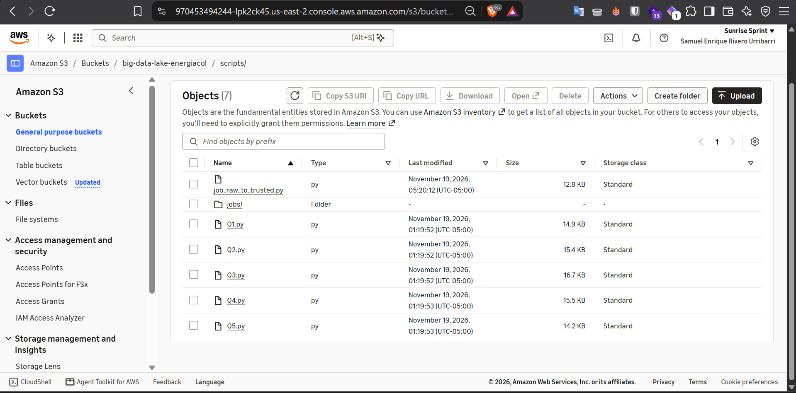
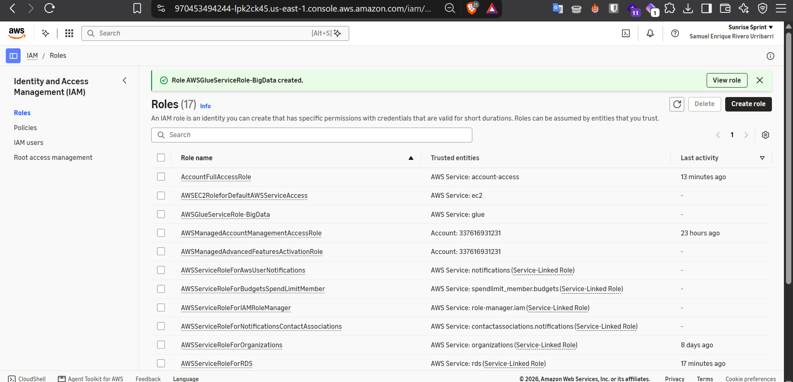
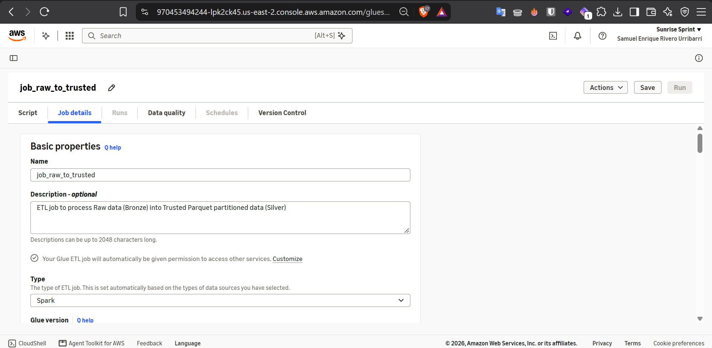
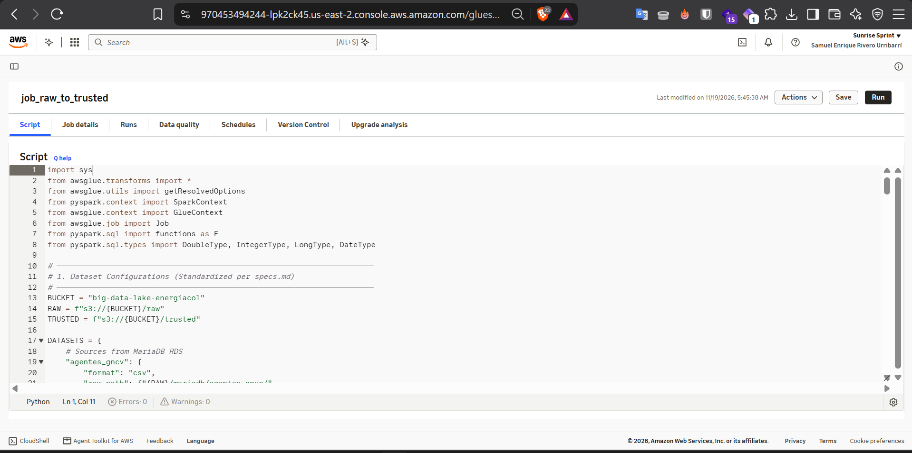
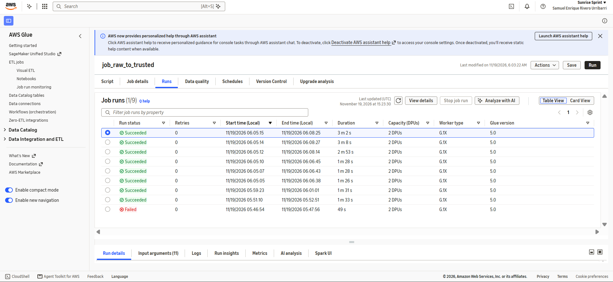

# Punto 4: Procesamiento de Datos (Raw → Trusted)

Este módulo implementa la capa de procesamiento y transformación distribuida dentro de la arquitectura Medallion / Lakehouse en Amazon S3.
Extrae los datos crudos e inmutables desde la zona **Raw (Bronze)** y genera datasets limpios, estandarizados, fuertemente tipados y optimizados para analítica en la zona **Trusted (Silver)** utilizando **AWS Glue** y **Apache Spark (PySpark)**.

---

## 1. Arquitectura y Flujo de Datos

```
┌──────────────────────────────────────────────┐
│           S3: ZONA RAW (Bronze)              │
│  - Archivos CSV crudos (MariaDB RDS, EC2)    │
│  - Chunks JSON paginados (Socrata Open Data) │
└──────────────────────┬───────────────────────┘
                       │
                       ▼
┌──────────────────────────────────────────────┐
│       AWS Glue Job / Apache Spark ETL        │
│  1. Ingesta por lotes (CSV / JSON)           │
│  2. Higiene común (trim, deduplicación)      │
│  3. Parseo numérico regional (Col vs US)     │
│  4. Tipado estricto y conversión de esquemas │
│  5. Estrategia de particionamiento físico    │
└──────────────────────┬───────────────────────┘
                       │
                       ▼
┌──────────────────────────────────────────────┐
│         S3: ZONA TRUSTED (Silver)            │
│  - Formato columnar optimizado Parquet       │
│  - Compresión Snappy                         │
│  - Distribución de carpetas estilo Hive      │
└──────────────────────────────────────────────┘
```

---

## 2. Decisiones Técnicas y Justificaciones

### ¿Por qué AWS Glue con PySpark?
- **Cómputo Serverless:** Elimina la sobrecarga operativa de aprovisionar y mantener servidores dedicados. Glue escala dinámicamente las unidades de procesamiento (DPUs) y se apaga al finalizar la ejecución, minimizando costos.
- **Motor Distribuido para Big Data:** PySpark gestiona con facilidad tanto dimensiones pequeñas (~1,700 filas en `agentes_gncv`) como tablas transaccionales masivas de más de 7 millones de registros (`distribuidores_mayoristas`).
- **Integración con Data Catalog:** Enlace directo con AWS Glue Data Catalog, habilitando de inmediato los motores de consulta analíticos posteriores (Punto 5 y 6: Metastore Hive y AWS Athena).

### ¿Por qué Parquet con Compresión Snappy?
- **Almacenamiento Columnar:** Las consultas SQL analíticas posteriores solo leen las columnas requeridas en las cláusulas `SELECT` y `WHERE`, reduciendo hasta un 80% los bytes escaneados y la latencia de entrada/salida.
- **Compresión Snappy:** Excelente equilibrio entre alta tasa de compresión y muy bajo consumo de CPU durante la descompresión.
- **Esquema Embebido:** Impone tipos de datos nativos estrictos (`LongType`, `DoubleType`, `DateType`, `IntegerType`), evitando inferencias erróneas durante las consultas.

### Estrategia de Particionamiento Físico (Estilo Hive)
Para evitar lecturas completas de tablas (*Full Table Scans*) en Athena y Spark:
- **Datasets Transaccionales de Combustibles y Subsidios** (`productores_b100e`, `ventas_gncv`, `beneficios_frontera`, `distribuidores_mayoristas`, `estaciones_servicio`): Particionados por **Año y Mes** (`anio_despacho/mes_despacho` o `anio_venta/mes_venta`).
- **Métricas Energéticas Internacionales** (`iea_electricity`): Particionado por **País y Año** (`country/year`).
- **Registro de Agentes** (`agentes_gncv`): Particionado por **Departamento** (`departamento`), siendo una dimensión geográfica de referencia.

---

## 3. Mapeo de Datasets y Rutas en S3

| Dataset | Origen S3 (Raw) | Formato Entrada | Destino S3 (Trusted) | Columnas de Partición |
|---|---|---|---|---|
| **Agentes GNCV** | `s3://.../raw/mariadb/agentes_gnvc/` | CSV | `s3://.../trusted/agentes_gncv/` | `departamento` |
| **Productores B100** | `s3://.../raw/mariadb/productores_b100E/` | CSV | `s3://.../trusted/productores_b100e/` | `anio_despacho`, `mes_despacho` |
| **Beneficio Frontera** | `s3://.../raw/ec2/beneficios-frontera/` | CSV | `s3://.../trusted/beneficios_frontera/` | `anio_beneficio`, `mes_beneficio` |
| **Ventas GNCV** | `s3://.../raw/ec2/ventas-gncv/` | CSV | `s3://.../trusted/ventas_gncv/` | `anio_venta`, `mes_venta` |
| **IEA Electricity** | `s3://.../raw/ec2/iea-monthly-electricity-statistics/` | CSV | `s3://.../trusted/iea_electricity/` | `country`, `year` |
| **Distribuidores Mayoristas** | `s3://.../raw/api/distribuidores_mayorista/` | JSON | `s3://.../trusted/distribuidores_mayoristas/` | `anio_despacho`, `mes_despacho` |
| **Estaciones de Servicio** | `s3://.../raw/api/estaciones_servicio/` | JSON | `s3://.../trusted/estaciones_servicio/` | `anio_despacho`, `mes_despacho` |

---

## 4. Instrucciones de Despliegue y Ejecución

### Opción A: Ejecución en la Nube con AWS Glue (Producción)

1. **Subir el script parametrizado a S3:**
   ```bash
   aws s3 cp glue_jobs/job_raw_to_trusted.py s3://big-data-lake-energiacol/scripts/job_raw_to_trusted.py
   ```

2. **Configuración del Glue Job:**
   - **Nombre:** `job_raw_to_trusted`
   - **Rol IAM:** Rol asignado con política `AWSGlueServiceRole` y acceso a `s3://big-data-lake-energiacol/`.
   - **Tipo:** Spark ETL (Glue 5.0, Python 3).
   - **Maximum Concurrency:** 7 (permite ejecutar los 7 datasets simultáneamente).

3. **Ejecutar el Job para un dataset específico o todos en paralelo:**
   ```bash
   # Ejemplo para un dataset individual
   aws glue start-job-run --job-name job_raw_to_trusted --arguments '{"--dataset": "ventas_gncv"}'
   ```

---

### Opción B: Validación Local con PySpark (Desarrollo y Pruebas)

Se incluye un script ejecutor local para validar las transformaciones sobre muestras sin incurrir en costos de nube:

```bash
# Procesar un dataset individual localmente
python run_local_spark.py --dataset agentes_gncv

# Procesar todos los datasets locales disponibles
python run_local_spark.py --all
```
Los archivos Parquet particionados generados se guardan localmente en `punto-4-procesamiento/output_trusted/` (ignorado en Git mediante `.gitignore`).

#### Nota para Usuarios en Windows:
Apache Spark requiere permisos POSIX del sistema de archivos. Al escribir archivos Parquet en Windows local, Spark necesita los binarios `winutils.exe` y `hadoop.dll`. El script configura automáticamente `HADOOP_HOME` si estos binarios están ubicados en `punto-4-procesamiento/.hadoop/bin/`.

---

## 5. Evidencias de Ejecución y Capturas de Pantalla

Las siguientes capturas documentan el despliegue, configuración y ejecución exitosa de los trabajos ETL en AWS Glue:

### 1. Despliegue de Scripts en Amazon S3
Almacenamiento del script ETL parametrizado y scripts de analítica en `s3://big-data-lake-energiacol/scripts/`:


### 2. Aprovisionamiento del Rol de Servicio IAM
Rol `AWSGlueServiceRole-BigData` configurado con permisos de lectura/escritura en S3 y ejecución en Glue:


### 3. Configuración del Job en AWS Glue
Propiedades básicas del trabajo ETL (`job_raw_to_trusted`, Spark, Python 3, Glue 5.0, G.1X):


### 4. Código PySpark en el Editor de AWS Glue
Código fuente cargado y listo para ejecución dentro de la consola de AWS Glue:


### 5. Historial de Ejecuciones Exitosas (SUCCEEDED)
Historial que evidencia la finalización con estado `SUCCEEDED` de todos los datasets procesados hacia la capa Trusted:

