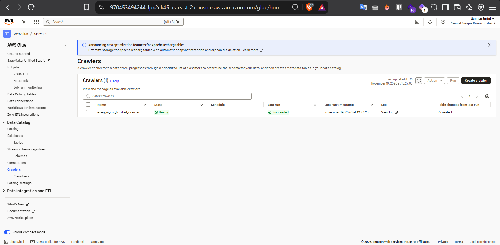
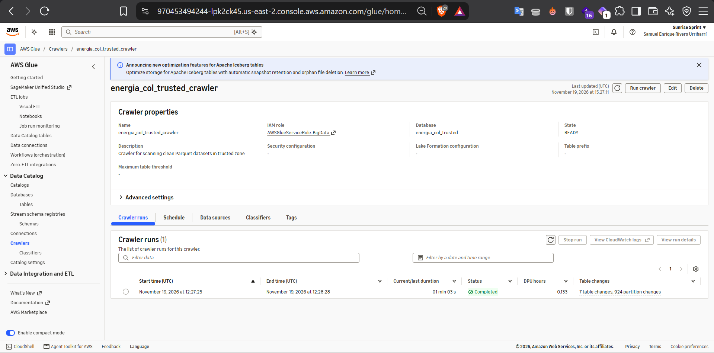
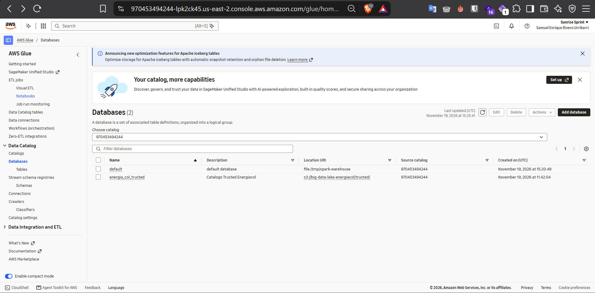
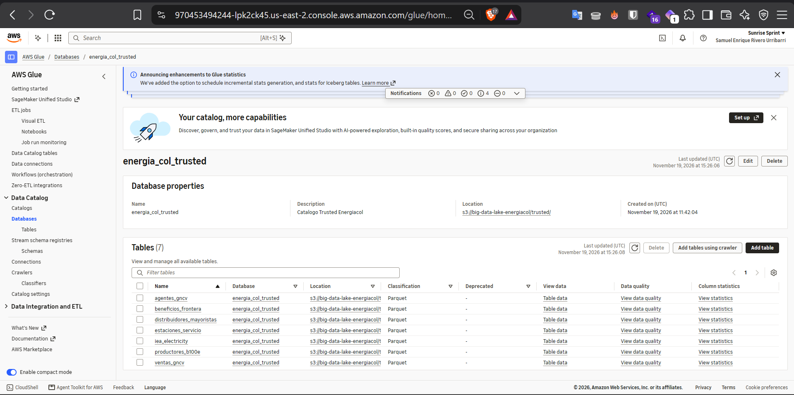
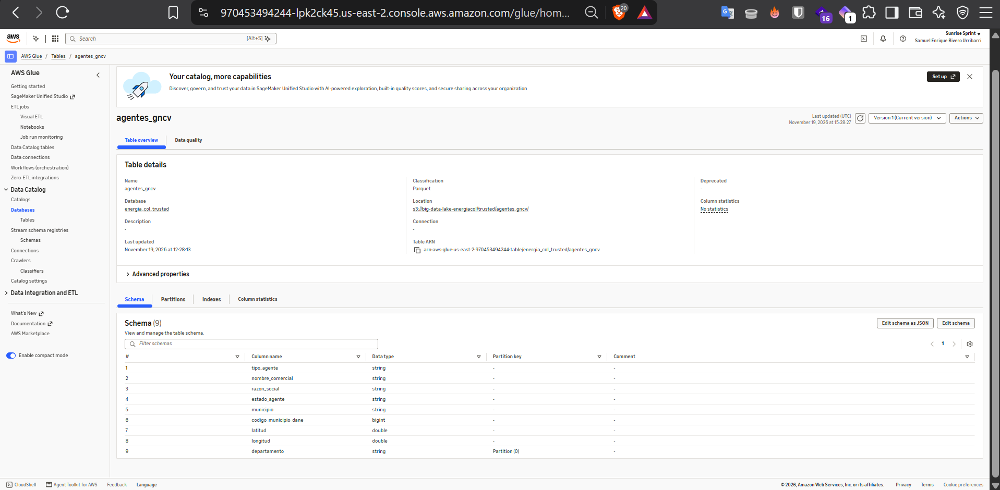
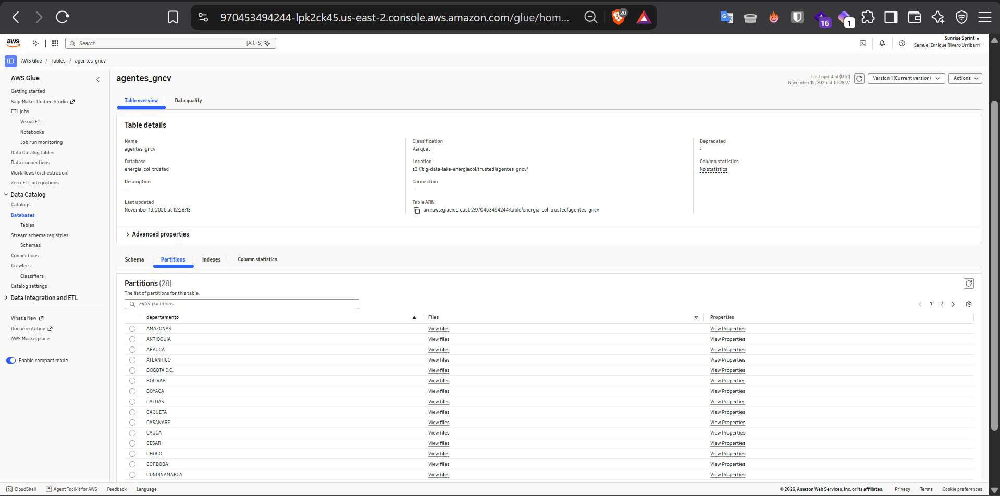
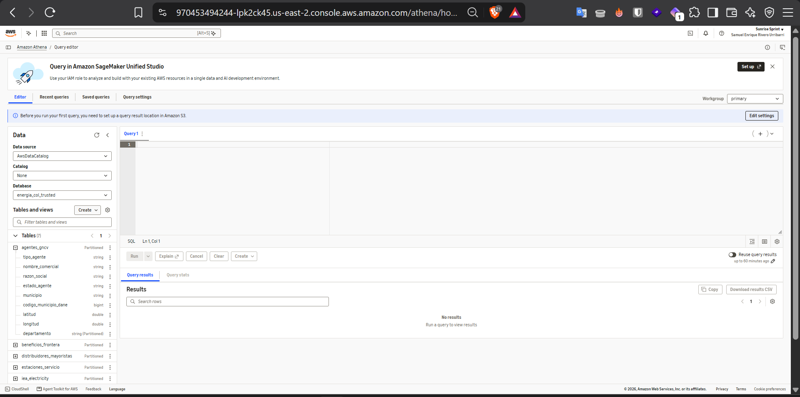

# Punto 5: Catalogación de Datos (AWS Glue Data Catalog & Metastore Hive)

Este módulo implementa la **capa de Catalogación de Datos** del Data Lakehouse.
Establece el puente entre el almacenamiento físico en formato Parquet en Amazon S3 (`s3://big-data-lake-energiacol/trusted/`) y los motores de consulta analítica (**AWS Athena**, **EMR/Hive** y **SparkSQL**), definiendo los esquemas, tipos de datos fuertemente tipados y metadatos de particionamiento en el **AWS Glue Data Catalog**.

---

## 1. Arquitectura de Catalogación

```
┌────────────────────────────────────────────────────────┐
│              S3: ZONA TRUSTED (Parquet)                │
│  s3://big-data-lake-energiacol/trusted/                │
│    ├── distribuidores_mayoristas/ (anio_despacho/mes)  │
│    ├── estaciones_servicio/       (anio_despacho/mes)  │
│    ├── beneficios_frontera/       (anio_beneficio/mes) │
│    ├── ventas_gncv/               (anio_venta/mes)     │
│    ├── productores_b100e/         (anio_despacho/mes)  │
│    ├── agentes_gncv/              (departamento)       │
│    └── iea_electricity/          (country/year)       │
└───────────────────────────┬────────────────────────────┘
                            │
              ┌─────────────┴─────────────┐
              ▼                           ▼
    ┌───────────────────┐       ┌───────────────────┐
    │  Método A: Glue   │       │  Método B: DDL    │
    │  Crawler (Python) │       │  Athena / Hive    │
    │  `crawler.py`     │       │  `01_create...sql`│
    └─────────┬─────────┘       └─────────┬─────────┘
              │                           │
              └─────────────┬─────────────┘
                            ▼
┌────────────────────────────────────────────────────────┐
│                 AWS GLUE DATA CATALOG                  │
│  Base de Datos: `energia_col_trusted`                  │
│  - 7 Tablas Externas Parquet fuertemente tipadas       │
│  - Metadatos para poda de particiones (Partition Pruning)
└───────────────────────────┬────────────────────────────┘
                            │
                            ▼ (Punto 6: Analítica SQL)
┌────────────────────────────────────────────────────────┐
│                 MOTORES DE CONSULTA                    │
│       AWS Athena  │  Apache Hive (EMR)  │  SparkSQL    │
└────────────────────────────────────────────────────────┘
```

---

## 2. Tablas Catalogadas y Resumen de Esquemas

Base de Datos: **`energia_col_trusted`**

| Nombre de Tabla | Ubicación en S3 (`s3://.../trusted/`) | Formato | Compresión | Llaves de Partición |
|---|---|---|---|---|
| **`distribuidores_mayoristas`** | `trusted/distribuidores_mayoristas/` | Parquet | SNAPPY | `anio_despacho` (INT), `mes_despacho` (INT) |
| **`estaciones_servicio`** | `trusted/estaciones_servicio/` | Parquet | SNAPPY | `anio_despacho` (INT), `mes_despacho` (INT) |
| **`beneficios_frontera`** | `trusted/beneficios_frontera/` | Parquet | SNAPPY | `anio_beneficio` (INT), `mes_beneficio` (INT) |
| **`ventas_gncv`** | `trusted/ventas_gncv/` | Parquet | SNAPPY | `anio_venta` (INT), `mes_venta` (INT) |
| **`productores_b100e`** | `trusted/productores_b100e/` | Parquet | SNAPPY | `anio_despacho` (INT), `mes_despacho` (INT) |
| **`agentes_gncv`** | `trusted/agentes_gncv/` | Parquet | SNAPPY | `departamento` (STRING) |
| **`iea_electricity`** | `trusted/iea_electricity/` | Parquet | SNAPPY | `country` (STRING), `year` (INT) |

---

## 3. Métodos de Catalogación Disponibles

### Método A: AWS Glue Crawler Automatizado (`crawler.py`)
Aprovisiona la base de datos y configura un Crawler de AWS Glue que escanea automáticamente todo el prefijo `trusted/` en S3.

**Requisitos Previos:**
* Rol IAM con la política `AWSGlueServiceRole` y permisos de lectura sobre `s3://big-data-lake-energiacol/trusted/`.
* Configurar `GLUE_ROLE_ARN` en el archivo `.env`:
  ```env
  GLUE_ROLE_ARN=arn:aws:iam::<account_id>:role/<role-name>
  ```

**Ejecución:**
```powershell
# Crear o actualizar la Base de Datos y el Crawler
python punto-5-catalogacion/crawler.py

# O crear Y ejecutar el crawler en un solo paso
python punto-5-catalogacion/crawler.py --run
```

---

### Método B: Scripts DDL Determinísticos en SQL (`01_create_tables.sql`)
Pueden ejecutarse directamente en el **Editor de Consultas de AWS Athena** o en el CLI de Hive en EMR:

1. Abrir **Consola AWS → Athena → Query Editor**.
2. Configurar la ubicación de resultados de consulta en S3 (`s3://big-data-lake-energiacol/athena-results/`).
3. Pegar y ejecutar las sentencias DDL de [`01_create_tables.sql`](./01_create_tables.sql).
4. Ejecutar `MSCK REPAIR TABLE <nombre_tabla>;` para registrar todas las particiones descubiertas en S3.

---

## 4. Verificación y Validación

Una vez catalogadas las tablas, se comprueba su correcto registro ejecutando estas consultas en Athena:

```sql
-- 1. Verificar tablas creadas en el catálogo
SHOW TABLES IN energia_col_trusted;

-- 2. Verificar descubrimiento de particiones
SHOW PARTITIONS energia_col_trusted.distribuidores_mayoristas;

-- 3. Muestra de filas
SELECT * FROM energia_col_trusted.ventas_gncv LIMIT 5;
```

---

## 5. Evidencias de Catalogación y Capturas de Pantalla

Las siguientes capturas documentan el aprovisionamiento del catálogo en Glue Data Catalog, la ejecución del Crawler y su integración con AWS Athena:

### 1. Estado del AWS Glue Crawler
El crawler automatizado `energia_col_trusted_crawler` en estado `READY` con su última ejecución en `SUCCEEDED`:


### 2. Métricas de Ejecución del Crawler (Particiones Descubiertas)
Registro de ejecución detallado indicando **7 tablas creadas** y **924 particiones descubiertas** automáticamente en S3:


### 3. Base de Datos en Glue Data Catalog
Base de datos `energia_col_trusted` aprovisionada con ubicación `s3://big-data-lake-energiacol/trusted/`:


### 4. Lista de Tablas Catalogadas en Formato Parquet
Las 7 tablas del Data Lakehouse catalogadas con clasificación `Parquet`:


### 5. Definición del Esquema de Columnas
Esquema fuertemente tipado de la tabla `agentes_gncv` (códigos DANE como `bigint`, coordenadas geográficas como `double`, llave de partición como `departamento`):


### 6. Metadatos de Particiones
Particiones físicas descubiertas para `agentes_gncv` correspondientes a los departamentos de Colombia:


### 7. Integración con el Editor de Consultas de AWS Athena
AWS Athena conectado de forma Serverless a `energia_col_trusted` en el `AwsDataCatalog`, con las 7 tablas listas para consulta analítica:

