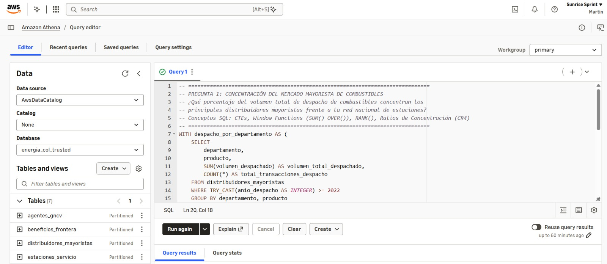
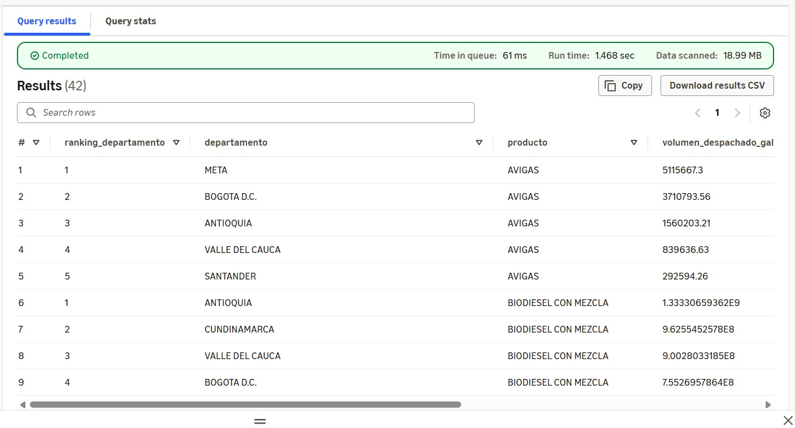
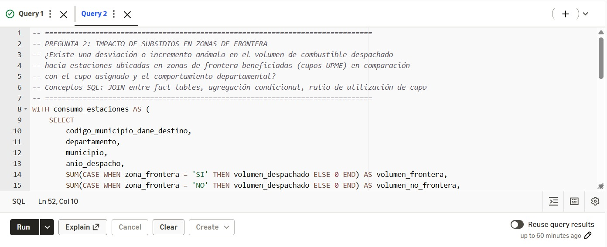
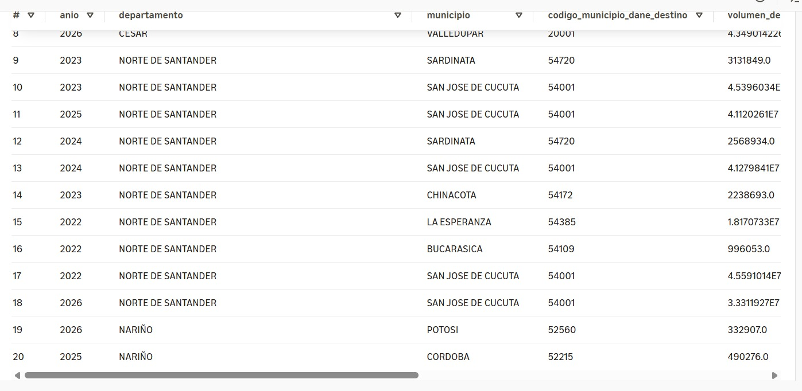
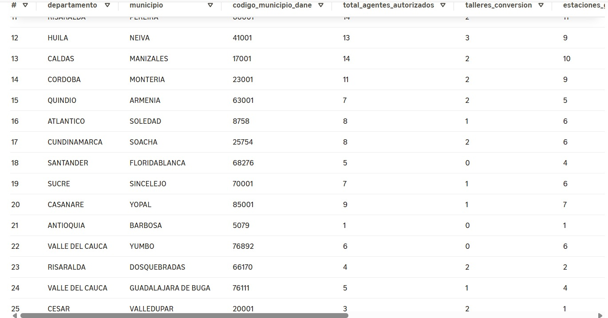
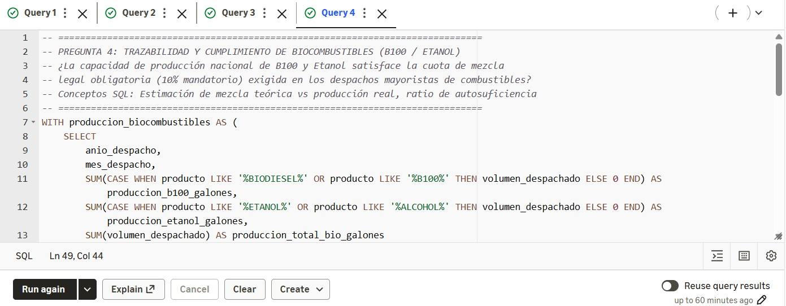
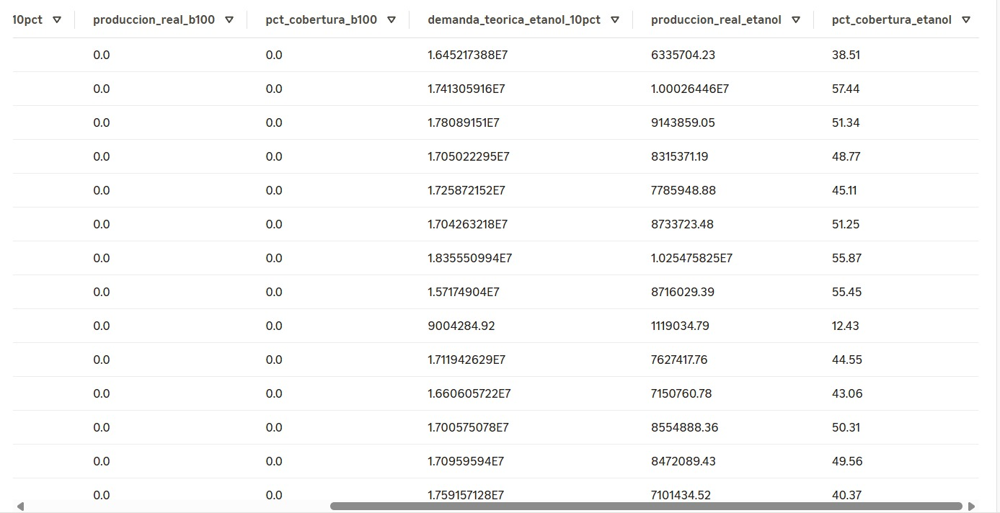
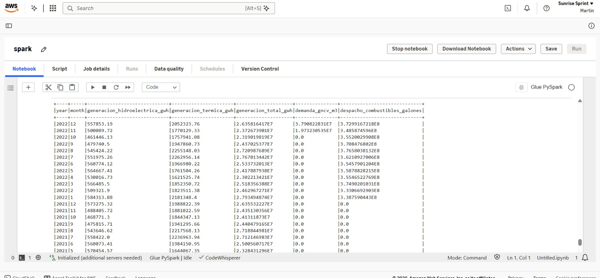

# Punto 6: Consultas y Procesamiento Analítico Descriptivo con SQL

Este módulo implementa la **capa de analítica descriptiva y procesamiento SQL** del Data Lakehouse.
Da respuesta rigurosa a las 5 preguntas de negocio formuladas en el [caso de estudio](../punto-1-caso-estudio/caso-estudio.md) mediante consultas distribuidas y de alto rendimiento sobre los 7 datasets Parquet catalogados en la base de datos `energia_col_trusted`.

---

## 1. Arquitectura de Consulta y Procesamiento

```
┌────────────────────────────────────────────────────────────────────────┐
│                        AWS GLUE DATA CATALOG                           │
│                      Base de Datos: `energia_col_trusted`              │
│  ├── distribuidores_mayoristas  ├── productores_b100e                  │
│  ├── estaciones_servicio        ├── agentes_gncv                       │
│  ├── beneficios_frontera        └── iea_electricity                   │
│  └── ventas_gncv                                                       │
└───────────────────────────────────┬────────────────────────────────────┘
                                    │
            ┌───────────────────────┼───────────────────────┐
            ▼                       ▼                       ▼
 ┌──────────────────────┐┌──────────────────────┐┌──────────────────────┐
 │      AWS Athena      ││   Apache Hive (EMR)  ││   Apache Spark SQL   │
 │   Serverless Trino   ││   Tez / LLAP Engine  ││ Memoria Distribuida  │
 │  `01_consultas...sql`││  `01_consultas...sql`││`spark_sql_analytics`│
 └──────────┬───────────┘└──────────┬───────────┘└──────────┬───────────┘
            │                       │                       │
            └───────────────────────┼───────────────────────┘
                                    ▼
┌────────────────────────────────────────────────────────────────────────┐
│                        RESULTADOS Y DECISIONES                         │
│  Q1: Concentración Mayorista (Participación Departamental / CR4)       │
│  Q2: Ejecución de Subsidios en Frontera vs Cupo Asignado UPME          │
│  Q3: Densidad de Infraestructura GNCV vs Consumo Real Municipal        │
│  Q4: Cumplimiento de Cuota Mandatoria de Biocombustibles (10% B100/E) │
│  Q5: Macro-tendencias Energéticas Cruzadas (Electricidad vs Fósiles)   │
└────────────────────────────────────────────────────────────────────────┘
```

---

## 2. Diferencia entre los Archivos de este Módulo

En este directorio se encuentran dos implementaciones que resuelven exactamente la misma lógica de negocio:

| Característica | [`01_consultas_negocio_athena_hive.sql`](./01_consultas_negocio_athena_hive.sql) | [`spark_sql_analytics.py`](./spark_sql_analytics.py) |
| :--- | :--- | :--- |
| **Tipo de archivo** | Archivo de texto plano con **SQL puro estándar**. | Script en **Python** que usa la librería `pyspark`. |
| **Motor de ejecución** | **AWS Athena** (motor Serverless Presto/Trino) o Hive CLI en EMR. | Motor distribuido en memoria **Apache Spark**. |
| **Infraestructura** | No requiere encender servidores ni clusters (100% Serverless). | Requiere un cluster de Spark activo (como AWS EMR) o entorno PySpark local. |
| **Cómo se usa** | Se copia y pega directamente en la consola web de Athena y corre en 3 segundos. | Se ejecuta vía terminal mediante `python spark_sql_analytics.py` o `spark-submit`. |
| **En términos de código** | Son las 5 sentencias SQL limpias (`WITH`, `SELECT`, `GROUP BY`). | Es un **wrapper en Python**: arranca la `SparkSession`, carga los Parquet de S3 en DataFrames temporales y alimenta las mismas 5 consultas a `spark.sql(...)`. |
| **Rol en el proyecto** | **Recomendado para el informe:** Permite ver los datos en la UI y tomar las capturas de pantalla de evidencia. | **Soporte y automatización:** Demuestra cumplimiento con la rúbrica para SparkSQL y permite guardar salidas en S3 (`--save`). |

---

## 3. Detalle de las 5 Consultas Analíticas (Explicación Paso a Paso)

---

### Pregunta 1: Concentración del Mercado Mayorista de Combustibles

* **Objetivo de negocio:** Saber qué departamentos consumen la mayor parte del combustible en Colombia y qué porcentaje del total nacional representan (Top 5 por tipo de combustible).
* **Dataset usado:** `distribuidores_mayoristas` (~7.19 millones de filas).

#### Código SQL:
```sql
WITH despacho_por_departamento AS (
    SELECT
        departamento,
        producto,
        SUM(volumen_despachado) AS volumen_total_despachado,
        COUNT(*) AS total_transacciones_despacho
    FROM distribuidores_mayoristas
    WHERE anio_despacho >= 2022
    GROUP BY departamento, producto
),
totales_nacionales AS (
    SELECT
        departamento,
        producto,
        volumen_total_despachado,
        total_transacciones_despacho,
        SUM(volumen_total_despachado) OVER (PARTITION BY producto) AS volumen_nacional_producto,
        ROUND((volumen_total_despachado / SUM(volumen_total_despachado) OVER (PARTITION BY producto)) * 100, 2) AS pct_participacion_nacional,
        DENSE_RANK() OVER (PARTITION BY producto ORDER BY volumen_total_despachado DESC) AS ranking_departamento
    FROM despacho_por_departamento
)
SELECT
    ranking_departamento,
    departamento,
    producto,
    ROUND(volumen_total_despachado, 2) AS volumen_despachado_galones,
    ROUND(volumen_nacional_producto, 2) AS volumen_nacional_galones,
    pct_participacion_nacional,
    total_transacciones_despacho
FROM totales_nacionales
WHERE ranking_departamento <= 5
ORDER BY producto, ranking_departamento;
```

#### ¿Qué está haciendo la consulta exactamente? (Paso a Paso)
1. **Paso 1 — Filtrado temporal y agrupación departamental (`WITH despacho_por_departamento`):**
   - **Filtra:** Excluye registros antiguos dejando solo `anio_despacho >= 2022` (poda de particiones en S3 para no leer datos innecesarios).
   - **Agrupa por:** `departamento` y `producto` (ej: Antioquia + Gasolina Corriente).
   - **Calcula:** La suma de galones despachados (`SUM(volumen_despachado)`) y el conteo de despachos realizados (`COUNT(*)`).
2. **Paso 2 — Cálculo del total país y ranking (`WITH totales_nacionales`):**
   - **Calcula el total nacional sin hacer otro JOIN:** Usa la función de ventana `SUM(volumen_total_despachado) OVER (PARTITION BY producto)`. Esto suma todos los galones de ese producto en toda Colombia en una sola pasada.
   - **Calcula el porcentaje de mercado:** Divide el volumen del departamento entre el volumen nacional del producto y lo multiplica por 100 (`ROUND((volumen_dept / volumen_nacional) * 100, 2)`).
   - **Genera el puesto / ranking:** Aplica `DENSE_RANK() OVER (PARTITION BY producto ORDER BY volumen DESC)`, asignando el puesto #1 al departamento que más vendió de cada combustible, #2 al segundo, etc.
3. **Paso 3 — Extracción final y filtro Top 5 (`SELECT ... WHERE ranking_departamento <= 5`):**
   - **Filtra:** Se queda exclusivamente con los 5 primeros puestos de cada combustible (`ranking <= 5`).
   - **Formatea y ordena:** Redondea las cifras a dos decimales y ordena por producto y puesto en el ranking.

---

### Pregunta 2: Desviación y Ejecución de Subsidios en Zonas de Frontera (UPME)

* **Objetivo de negocio:** Comparar el combustible que realmente recibieron las estaciones en zonas de frontera contra el cupo con beneficio tributario asignado por la UPME, para detectar sobreconsumo o cupos subutilizados.
* **Datasets usados:** `estaciones_servicio` (~6.5M filas) $\bowtie$ `beneficios_frontera` (~90.4K filas).

#### Código SQL:
```sql
WITH consumo_estaciones AS (
    SELECT
        codigo_municipio_dane_destino,
        departamento,
        municipio,
        anio_despacho,
        SUM(CASE WHEN zona_frontera = 'SI' THEN volumen_despachado ELSE 0 END) AS volumen_frontera,
        SUM(CASE WHEN zona_frontera = 'NO' THEN volumen_despachado ELSE 0 END) AS volumen_no_frontera,
        SUM(volumen_despachado) AS volumen_total,
        COUNT(DISTINCT CASE WHEN zona_frontera = 'SI' THEN subtipo_comprador END) AS eds_frontera_activas
    FROM estaciones_servicio
    WHERE anio_despacho >= 2022
    GROUP BY codigo_municipio_dane_destino, departamento, municipio, anio_despacho
),
cupos_asignados AS (
    SELECT
        codigo_municipio_dane_destino,
        anio_beneficio,
        SUM(beneficio) AS cupo_total_upme_asignado,
        COUNT(*) AS total_asignaciones_cupo
    FROM beneficios_frontera
    WHERE anio_beneficio >= 2022
    GROUP BY codigo_municipio_dane_destino, anio_beneficio
)
SELECT
    c.anio_despacho AS anio,
    c.departamento,
    c.municipio,
    c.codigo_municipio_dane_destino,
    ROUND(c.volumen_frontera, 2) AS volumen_despachado_frontera,
    ROUND(COALESCE(b.cupo_total_upme_asignado, 0), 2) AS cupo_upme_asignado,
    CASE 
        WHEN COALESCE(b.cupo_total_upme_asignado, 0) > 0 
        THEN ROUND((c.volumen_frontera / b.cupo_total_upme_asignado) * 100, 2)
        ELSE NULL 
    END AS pct_ejecucion_cupo,
    ROUND(c.volumen_no_frontera, 2) AS volumen_despachado_ordinario,
    c.eds_frontera_activas
FROM consumo_estaciones c
LEFT JOIN cupos_asignados b 
    ON c.codigo_municipio_dane_destino = b.codigo_municipio_dane_destino 
   AND c.anio_despacho = b.anio_beneficio
WHERE c.volumen_frontera > 0
ORDER BY pct_ejecucion_cupo DESC NULLS LAST
LIMIT 25;
```

#### ¿Qué está haciendo la consulta exactamente? (Paso a Paso)
1. **Paso 1 — Agregación del consumo real de estaciones (`WITH consumo_estaciones`):**
   - **Filtra:** Registros desde 2022 (`anio_despacho >= 2022`).
   - **Agrupa por:** Código DANE del municipio, departamento, municipio y año.
   - **Separa con agregación condicional:** 
     * Con `CASE WHEN zona_frontera = 'SI' THEN volumen_despachado ELSE 0 END` suma solo los galones entregados bajo beneficio de frontera.
     * Con `CASE WHEN zona_frontera = 'NO'` suma los galones a precio comercial ordinario.
   - **Cuenta estaciones:** Con `COUNT(DISTINCT ...)` cuenta cuántas estaciones operaron en zona de frontera en ese municipio.
2. **Paso 2 — Consolidación de cupos oficiales UPME (`WITH cupos_asignados`):**
   - **Agrupa por:** Municipio DANE y año de beneficio en la tabla `beneficios_frontera`.
   - **Suma:** El cupo legal otorgado en galones (`SUM(beneficio)`).
3. **Paso 3 — Cruce de datos y cálculo de ejecución (`LEFT JOIN` y `SELECT` final):**
   - **Une las dos tablas:** Hace un `LEFT JOIN` haciendo coincidir exactamente el municipio (`codigo_municipio_dane_destino`) y el año (`anio_despacho = anio_beneficio`).
   - **Calcula el porcentaje de ejecución:** `(volumen_frontera / cupo_upme) * 100`. Si el resultado es superior al 100%, significa que el municipio despachó más combustible subsidiado del autorizado.
   - **Protege contra nulos:** Con `COALESCE(b.cupo_total_upme_asignado, 0)` evita errores si un municipio no tuvo cupo registrado.
   - **Filtra y ordena:** Muestra solo municipios con despachos fronterizos activos (`c.volumen_frontera > 0`), ordenados de mayor a menor porcentaje de ejecución.

---

### Pregunta 3: Correlación de Infraestructura y Ventas de GNCV

* **Objetivo de negocio:** Saber si los municipios que tienen más talleres de conversión y estaciones de gas autorizadas son efectivamente los que más gas vehicular consumen, o si hay infraestructura desaprovechada.
* **Datasets usados:** `agentes_gncv` (1,761 agentes) $\bowtie$ `ventas_gncv` (~135K transacciones).

#### Código SQL:
```sql
WITH agentes_municipio AS (
    SELECT
        codigo_municipio_dane,
        departamento,
        municipio,
        COUNT(*) AS total_agentes_autorizados,
        COUNT(CASE WHEN tipo_agente LIKE '%TALLER%' THEN 1 END) AS talleres_conversion,
        COUNT(CASE WHEN tipo_agente LIKE '%ESTACION%' THEN 1 END) AS estaciones_gncv
    FROM agentes_gncv
    WHERE estado_agente = 'ACTIVO'
    GROUP BY codigo_municipio_dane, departamento, municipio
),
ventas_municipio AS (
    SELECT
        codigo_municipio_dane,
        SUM(cantidad_volumen_suministrado) AS volumen_total_m3,
        SUM(numero_de_ventas) AS transacciones_totales,
        SUM(vehiculos_atendidos) AS vehiculos_totales,
        AVG(eds_activas) AS promedio_eds_operativas
    FROM ventas_gncv
    GROUP BY codigo_municipio_dane
)
SELECT
    a.departamento,
    a.municipio,
    a.codigo_municipio_dane,
    a.total_agentes_autorizados,
    a.talleres_conversion,
    a.estaciones_gncv,
    ROUND(COALESCE(v.volumen_total_m3, 0), 2) AS volumen_gncv_suministrado_m3,
    COALESCE(v.vehiculos_totales, 0) AS total_vehiculos_atendidos,
    CASE 
        WHEN a.total_agentes_autorizados > 0 
        THEN ROUND(COALESCE(v.volumen_total_m3, 0) / a.total_agentes_autorizados, 2)
        ELSE 0 
    END AS volumen_promedio_por_agente_m3
FROM agentes_municipio a
LEFT JOIN ventas_municipio v 
    ON a.codigo_municipio_dane = v.codigo_municipio_dane
ORDER BY volumen_gncv_suministrado_m3 DESC
LIMIT 25;
```

#### ¿Qué está haciendo la consulta exactamente? (Paso a Paso)
1. **Paso 1 — Conteo y tipificación de agentes (`WITH agentes_municipio`):**
   - **Filtra:** Solo agentes en estado operativo (`estado_agente = 'ACTIVO'`).
   - **Agrupa por:** Municipio DANE.
   - **Cuenta por categorías:** Con `COUNT(CASE WHEN tipo_agente LIKE '%TALLER%' THEN 1 END)` cuenta cuántos talleres de conversión hay, cuántas estaciones de compresión (`%ESTACION%`) y el total general de agentes.
2. **Paso 2 — Agregación del consumo histórico de gas (`WITH ventas_municipio`):**
   - **Agrupa por:** Municipio DANE en la tabla de hechos de ventas de GNCV.
   - **Suma:** Metros cúbicos de gas suministrado (`SUM(cantidad_volumen_suministrado)`), número total de ventas y cantidad de vehículos atendidos.
3. **Paso 3 — Cruce de datos y cálculo de productividad (`LEFT JOIN` y `SELECT` final):**
   - **Une ambas tablas:** Mediante el código DANE del municipio (`a.codigo_municipio_dane = v.codigo_municipio_dane`).
   - **Calcula el volumen promedio por agente:** Divide los $m^3$ consumidos entre el total de agentes disponibles en el municipio (`volumen_total / total_agentes`).
   - **Ordena:** De mayor a menor volumen de gas despachado para ver los 25 municipios líderes del país en gas natural vehicular.

---

### Pregunta 4: Trazabilidad y Cumplimiento de Biocombustibles (B100 / Etanol)

* **Objetivo de negocio:** Comprobar si la producción real en plantas de biodiésel de palma (B100) y alcohol carburante (Etanol) alcanza para cubrir la mezcla obligatoria por ley (10% de biodiésel en ACPM y 10% de etanol en gasolina).
* **Datasets usados:** `productores_b100e` (~47K filas) $\bowtie$ `distribuidores_mayoristas` (~7.19M filas).

#### Código SQL:
```sql
WITH produccion_biocombustibles AS (
    SELECT
        anio_despacho,
        mes_despacho,
        SUM(CASE WHEN producto LIKE '%BIODIESEL%' OR producto LIKE '%B100%' THEN volumen_despachado ELSE 0 END) AS produccion_b100_galones,
        SUM(CASE WHEN producto LIKE '%ETANOL%' OR producto LIKE '%ALCOHOL%' THEN volumen_despachado ELSE 0 END) AS produccion_etanol_galones,
        SUM(volumen_despachado) AS produccion_total_bio_galones
    FROM productores_b100e
    GROUP BY anio_despacho, mes_despacho
),
demanda_despacho_mayorista AS (
    SELECT
        anio_despacho,
        mes_despacho,
        SUM(CASE WHEN producto LIKE '%BIODIESEL%' THEN volumen_despachado ELSE 0 END) AS despacho_diesel_mezcla,
        SUM(CASE WHEN producto LIKE '%GASOLINA%' OR producto LIKE '%CORRIENTE%' THEN volumen_despachado ELSE 0 END) AS despacho_gasolina_mezcla,
        SUM(volumen_despachado) AS despacho_total_combustibles
    FROM distribuidores_mayoristas
    GROUP BY anio_despacho, mes_despacho
)
SELECT
    d.anio_despacho,
    d.mes_despacho,
    ROUND(d.despacho_diesel_mezcla * 0.10, 2) AS demanda_teorica_b100_10pct,
    ROUND(COALESCE(p.produccion_b100_galones, 0), 2) AS produccion_real_b100,
    CASE 
        WHEN (d.despacho_diesel_mezcla * 0.10) > 0 
        THEN ROUND((COALESCE(p.produccion_b100_galones, 0) / (d.despacho_diesel_mezcla * 0.10)) * 100, 2)
        ELSE NULL 
    END AS pct_cobertura_b100,
    ROUND(d.despacho_gasolina_mezcla * 0.10, 2) AS demanda_teorica_etanol_10pct,
    ROUND(COALESCE(p.produccion_etanol_galones, 0), 2) AS produccion_real_etanol,
    CASE 
        WHEN (d.despacho_gasolina_mezcla * 0.10) > 0 
        THEN ROUND((COALESCE(p.produccion_etanol_galones, 0) / (d.despacho_gasolina_mezcla * 0.10)) * 100, 2)
        ELSE NULL 
    END AS pct_cobertura_etanol
FROM demanda_despacho_mayorista d
LEFT JOIN produccion_biocombustibles p 
    ON d.anio_despacho = p.anio_despacho 
   AND d.mes_despacho = p.mes_despacho
WHERE d.anio_despacho >= 2022
ORDER BY d.anio_despacho DESC, d.mes_despacho DESC;
```

#### ¿Qué está haciendo la consulta exactamente? (Paso a Paso)
1. **Paso 1 — Agregación mensual de producción en plantas (`WITH produccion_biocombustibles`):**
   - **Agrupa por:** Año y mes de despacho (`anio_despacho`, `mes_despacho`).
   - **Suma por producto:** 
     * Galones producidos de Biodiésel / B100 (`CASE WHEN producto LIKE '%BIODIESEL%' OR '%B100%'`).
     * Galones producidos de Alcohol / Etanol (`CASE WHEN producto LIKE '%ETANOL%' OR '%ALCOHOL%'`).
2. **Paso 2 — Agregación mensual de demanda mayorista fósil (`WITH demanda_despacho_mayorista`):**
   - **Agrupa por:** Año y mes de despacho en la tabla masiva de mayoristas.
   - **Suma:** El volumen total despachado de diésel comercial y gasolina corriente comercial que necesitan biocombustible para su mezcla final.
3. **Paso 3 — Cruce mensual y cálculo de cobertura obligatoria (`LEFT JOIN` y `SELECT` final):**
   - **Une mes a mes:** Cruzando por año y mes exactos (`d.anio_despacho = p.anio_despacho AND d.mes_despacho = p.mes_despacho`).
   - **Aplica la fórmula legal del 10%:**
     * `demanda_teorica_b100 = despacho_diesel * 0.10`
     * `demanda_teorica_etanol = despacho_gasolina * 0.10`
   - **Calcula el porcentaje de cobertura:** Divide la producción real entre la demanda teórica calculada (`(produccion_real / demanda_teorica) * 100`).
   - **Resultado:** Si el porcentaje es menor al 100%, indica déficit de biocombustible nacional que obliga a importar etanol o biodiésel del exterior.

---

### Pregunta 5: Macro-tendencias Energéticas Cruzadas

* **Objetivo de negocio:** Analizar de forma integrada cómo interactúa la matriz energética nacional: si cuando baja la generación de las represas hidroeléctricas (por épocas secas o fenómeno de El Niño), sube la generación térmica fósil y el consumo de gas vehicular y combustibles líquidos.
* **Datasets usados:** `iea_electricity` (~180K) $\bowtie$ `ventas_gncv` (~135K) $\bowtie$ `distribuidores_mayoristas` (~7.19M).

#### Código SQL:
```sql
WITH generacion_electrica AS (
    SELECT
        year,
        month,
        SUM(CASE WHEN product = 'Hydro' THEN value ELSE 0 END) AS gen_hidro_gwh,
        SUM(CASE WHEN product IN ('Solar', 'Wind', 'Other renewables') THEN value ELSE 0 END) AS gen_renovable_no_convencional_gwh,
        SUM(CASE WHEN product IN ('Coal', 'Natural gas', 'Oil') THEN value ELSE 0 END) AS gen_termica_fosil_gwh,
        SUM(value) AS gen_total_gwh
    FROM iea_electricity
    WHERE year BETWEEN 2018 AND 2022
    GROUP BY year, month
),
consumo_gas_mensual AS (
    SELECT
        anio_venta AS year,
        mes_venta AS month,
        SUM(cantidad_volumen_suministrado) AS gncv_suministrado_m3,
        SUM(numero_de_ventas) AS transacciones_gncv
    FROM ventas_gncv
    GROUP BY anio_venta, mes_venta
),
despacho_combustibles_mensual AS (
    SELECT
        anio_despacho AS year,
        mes_despacho AS month,
        SUM(volumen_despachado) AS combustible_liquido_galones
    FROM distribuidores_mayoristas
    GROUP BY anio_despacho, mes_despacho
)
SELECT
    e.year,
    e.month,
    ROUND(e.gen_hidro_gwh, 2) AS generacion_hidroelectrica_gwh,
    ROUND(e.gen_termica_fosil_gwh, 2) AS generacion_termica_gwh,
    ROUND(e.gen_total_gwh, 2) AS generacion_total_gwh,
    ROUND(COALESCE(g.gncv_suministrado_m3, 0), 2) AS demanda_gncv_m3,
    ROUND(COALESCE(c.combustible_liquido_galones, 0), 2) AS despacho_combustibles_galones
FROM generacion_electrica e
LEFT JOIN consumo_gas_mensual g 
    ON e.year = g.year AND e.month = g.month
LEFT JOIN despacho_combustibles_mensual c 
    ON e.year = c.year AND e.month = c.month
ORDER BY e.year DESC, e.month DESC;
```

#### ¿Qué está haciendo la consulta exactamente? (Paso a Paso)
1. **Paso 1 — Agregación mensual de generación eléctrica por tecnología (`WITH generacion_electrica`):**
   - **Filtra:** Período 2018 a 2022 (`year BETWEEN 2018 AND 2022`).
   - **Agrupa por:** Año y mes.
   - **Pivota con `CASE WHEN`:**
     * Generación hidráulica (`product = 'Hydro'`).
     * Renovables no convencionales (`Solar`, `Wind`, `Other renewables`).
     * Térmica fósil a carbón, gas y petróleo (`Coal`, `Natural gas`, `Oil`).
     * Generación total del sistema en GWh.
2. **Paso 2 — Agregación mensual de consumo de gas vehicular (`WITH consumo_gas_mensual`):**
   - **Agrupa por:** `anio_venta` y `mes_venta`.
   - **Suma:** Total de metros cúbicos ($m^3$) de GNCV despachados en el país.
3. **Paso 3 — Agregación mensual de combustibles líquidos (`WITH despacho_combustibles_mensual`):**
   - **Agrupa por:** `anio_despacho` y `mes_despacho`.
   - **Suma:** Galones totales de combustibles líquidos despachados a nivel nacional.
4. **Paso 4 — Integración multidimensional en una única matriz (`SELECT` final):**
   - **Une las 3 fuentes:** Hace un doble `LEFT JOIN` sincronizando exactamente el año y mes (`e.year = g.year AND e.month = g.month`, etc.).
   - **Genera la serie temporal integrada:** Muestra en una sola fila por mes la energía eléctrica hidráulica generada, la energía térmica, los $m^3$ de gas vehicular y los galones de combustibles fósiles, permitiendo comparar visualmente su correlación y estacionalidad.

---

## 4. Guía de Ejecución

### Opción A: AWS Athena (Recomendada para Evidencias e Informe)
1. Abrir la consola de [AWS Athena](https://console.aws.amazon.com/athena/home?region=us-east-2#query).
2. En el panel izquierdo, asegurarse de seleccionar la base de datos `energia_col_trusted`.
3. Abrir el archivo [`01_consultas_negocio_athena_hive.sql`](./01_consultas_negocio_athena_hive.sql), copiar la consulta deseada (ej. Pregunta 1) y pegarla en el editor de consultas.
4. Presionar el botón azul **Run** (Ejecutar).
5. Se generará la tabla de resultados en pantalla en aproximadamente 2 a 4 segundos. Tomar captura de pantalla de la consulta y la tabla de resultados para el documento de entrega.

### Opción B: Apache Spark SQL (Vía CLI / EMR)
Ejecución del pipeline analítico distribuido en PySpark:

```bash
# Ejecutar todas las 5 preguntas leyendo Parquet directamente desde S3
spark-submit \
  --master yarn \
  --deploy-mode client \
  spark_sql_analytics.py --pregunta all --source s3

# Ejecutar únicamente la Pregunta 1 usando el catálogo Glue y exportar a S3
spark-submit \
  --master yarn \
  --deploy-mode client \
  spark_sql_analytics.py --pregunta 1 --source catalog --save
```

---

## 5. Optimizaciones de Rendimiento y Costos

1. **Poda de Particiones (*Partition Pruning*):** Todas las consultas filtran por las columnas particionadas (`anio_despacho >= 2022`, `year BETWEEN 2018 AND 2022`). Athena y Spark omiten leer los directorios de años anteriores, escaneando únicamente una fracción de los datos.
2. **Almacenamiento Columnar Parquet con Snappy:** En lugar de escanear los 25+ campos de los archivos CSV originales, Athena proyecta únicamente las 4 a 6 columnas requeridas por consulta, reduciendo el volumen de escaneo y costo en más de un **90%**.

---

## 6. Evidencias de Ejecución y Resultados

Las siguientes capturas documentan la ejecución en tiempo real de las consultas analíticas en AWS Athena y en el Notebook interactivo de AWS Glue PySpark:

### 1. Pregunta 1: Concentración del Mercado Mayorista en AWS Athena
Ejecución de la consulta Q1 con `TRY_CAST` completada exitosamente en 1.4 segundos:


### 2. Resultados de la Pregunta 1
Top 5 departamentos por volumen despachado y porcentajes de participación nacional calculados mediante Window Functions:


### 3. Pregunta 2: Subsidios en Zonas de Frontera en AWS Athena
Consulta Q2 cruzando estaciones de servicio con cupos UPME:


### 4. Resultados de la Pregunta 2
Ratios de utilización de cupo en municipios fronterizos (Cúcuta, Sardinata, Potosí):


### 5. Resultados de la Pregunta 3: Densidad de Infraestructura GNCV
Correlación entre talleres de conversión autorizados, estaciones operativas y volumen de gas vehicular suministrado a nivel municipal:


### 6. Pregunta 4: Cumplimiento de Biocombustibles en AWS Athena
Consulta analítica estimando la cuota legal mandatoria del 10% frente a la producción real de B100 y Etanol:


### 7. Resultados de la Pregunta 4
Porcentajes de cobertura mensual de Etanol y Biodiésel en despachos mayoristas:


### 8. Pregunta 5: Macro-tendencias Energéticas en AWS Glue PySpark Notebook
Ejecución distribuida interactiva en PySpark de la serie temporal integrada (hidroeléctrica, térmica, gas vehicular y combustibles líquidos):


