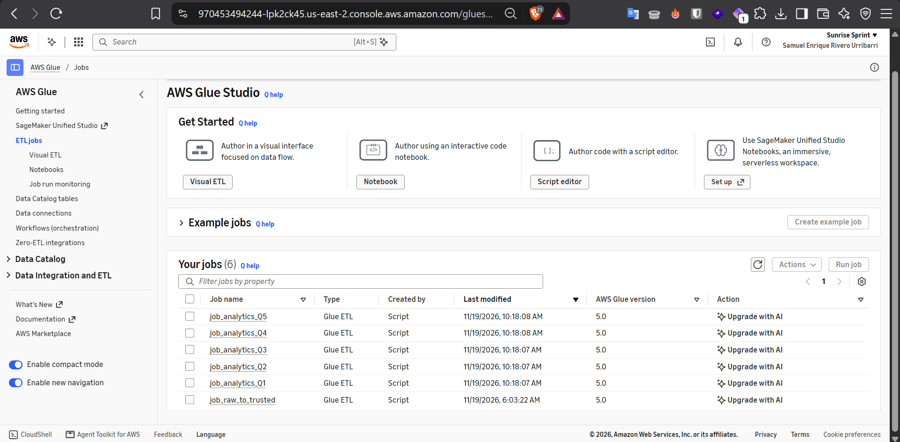
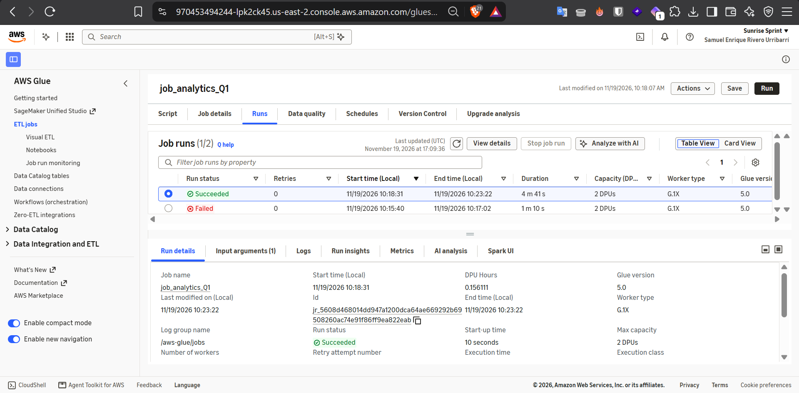
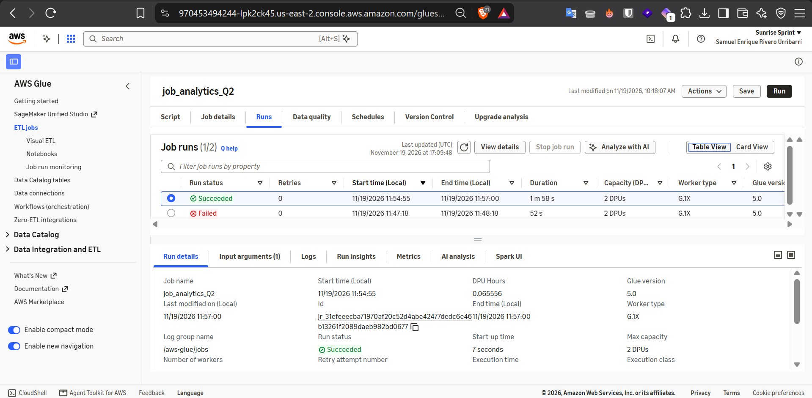
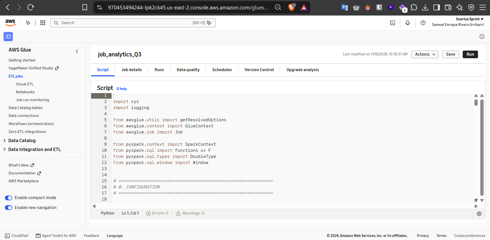
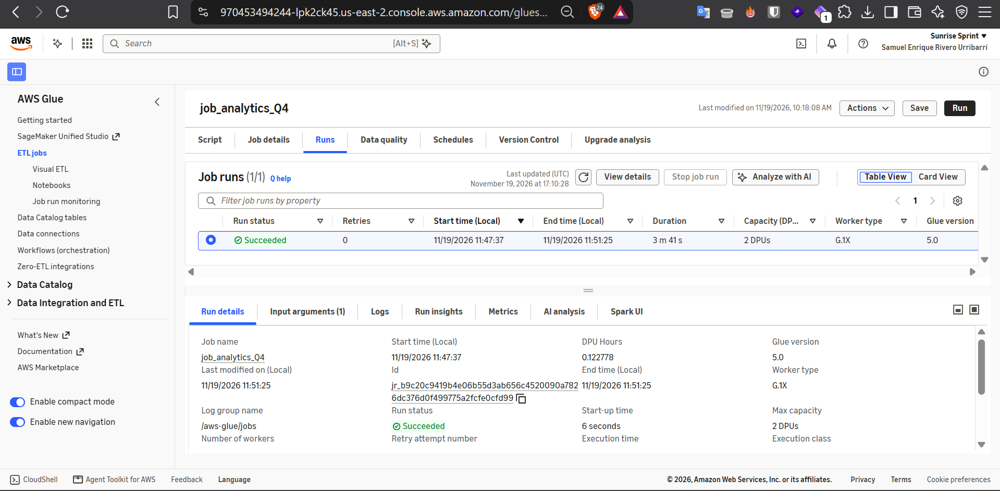
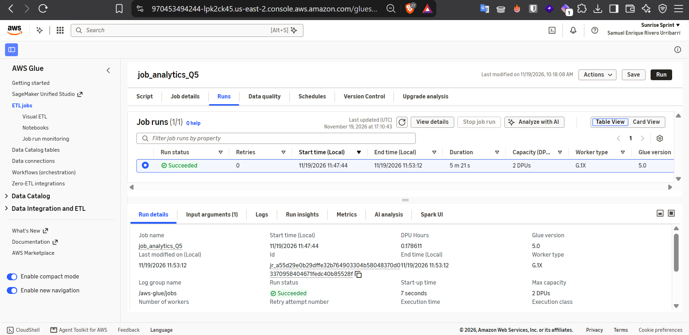
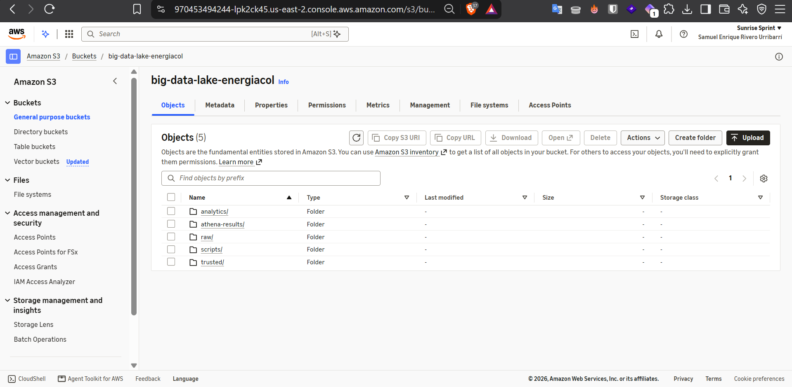
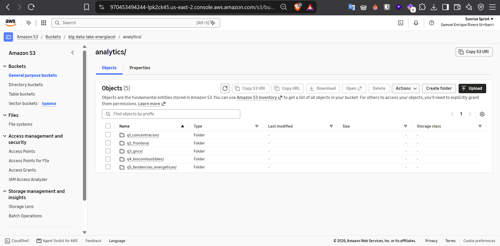
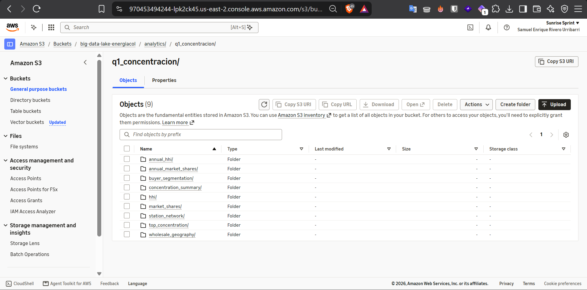

# 7. Desarrollo de la capa Analytics — AWS Glue y PySpark

## 7.1. Objetivo

Se desarrolló una capa analítica utilizando AWS Glue y PySpark para responder las cinco preguntas de negocio definidas en el proyecto Energía Colombia.

Se implementaron cinco trabajos independientes, cada uno encargado de leer las tablas de la capa Trusted, realizar transformaciones y agregaciones específicas, y almacenar los resultados en Amazon S3 en formato Parquet con compresión Snappy.

La arquitectura permite ejecutar, validar y mantener cada análisis de manera independiente.

## 7.2. Estructura de los trabajos

Los scripts desarrollados se ubican en el subdirectorio `jobs/` y se encuentran asociados a sus respectivos trabajos en AWS Glue:

```text
jobs/
├── Q1.py   (job_analytics_Q1: Concentración de mercado y cálculo de HHI)
├── Q2.py   (job_analytics_Q2: Subsidios en frontera y detección de anomalías)
├── Q3.py   (job_analytics_Q3: Infraestructura y ventas de GNCV)
├── Q4.py   (job_analytics_Q4: Trazabilidad y balance de biocombustibles)
└── Q5.py   (job_analytics_Q5: Macrotendencias y correlaciones energéticas)
```

Los scripts se almacenan en S3 para la ejecución serverless en Glue:

```text
s3://big-data-lake-energiacol/scripts/punto-7-pyspark-analitico/jobs/
```

Los resultados analíticos en formato Parquet se almacenan en:

```text
s3://big-data-lake-energiacol/analytics/
```

## 7.3. Configuración de AWS Glue

Los trabajos se desarrollaron utilizando PySpark sobre AWS Glue.

Configuración inicial:

| Parámetro | Valor |
|---|---|
| Glue Version | 5.0 |
| Worker Type | G.1X |
| Number of Workers | 5 |
| Output Format | Parquet |
| Compression | Snappy |
| Temporary Directory | `s3://big-data-lake-energiacol/temp/` |
| Trusted Database | `energia_col_trusted` |

Los scripts utilizan las tablas del Glue Data Catalog como fuentes de información y escriben sus resultados directamente en S3.

## 7.4. Q1 — Concentración del mercado mayorista

**Script:** `q1_concentracion_mercado.py`

**Tablas de entrada:**
- `distribuidores_mayoristas`
- `estaciones_servicio`

**Objetivo:** analizar la distribución de los despachos mayoristas y calcular indicadores de concentración del mercado.

### Procesamiento implementado

1. Normalización de variables temporales y categóricas.
2. Agregación de volúmenes por proveedor, producto y periodo.
3. Cálculo de participaciones de mercado.
4. Cálculo del índice Herfindahl-Hirschman (HHI).
5. Identificación de los principales grupos mediante rankings Top 5 y Top 10.
6. Agregación anual de participaciones e indicadores de concentración.
7. Segmentación de despachos según tipo de comprador.
8. Análisis geográfico de proveedores y estaciones de servicio.

### Resultados

```text
analytics/q1_concentracion/
├── market_shares/
├── hhi/
├── top_concentration/
├── annual_market_shares/
├── annual_hhi/
├── buyer_segmentation/
├── station_network/
├── wholesale_geography/
└── concentration_summary/
```

### Consideraciones

Debido a la ausencia de un identificador empresarial único en el esquema utilizado, `tipo_proveedor` se empleó como agrupación provisional para calcular las participaciones y el HHI.

En consecuencia, el resultado representa concentración entre categorías de proveedores y no concentración empresarial efectiva.

## 7.5. Q2 — Impacto de los subsidios en zonas de frontera

**Script:** `q2_subsidios_frontera.py`

**Tablas de entrada:**
- `estaciones_servicio`
- `beneficios_frontera`

**Objetivo:** comparar los despachos de combustible en municipios fronterizos y no fronterizos, e identificar comportamientos estadísticamente atípicos.

### Procesamiento implementado

1. Normalización de los indicadores de zona de frontera.
2. Agregación de despachos por municipio, producto y periodo.
3. Comparación de volúmenes entre zonas fronterizas y no fronterizas.
4. Cálculo de promedios municipales.
5. Identificación de anomalías mediante puntuaciones Z.
6. Agregación mensual de beneficios.
7. Integración de beneficios y despachos por municipio.

### Resultados

```text
analytics/q2_frontera/
├── municipal_dispatches/
├── border_vs_non_border/
├── border_anomalies/
├── benefits_monthly/
├── benefits_by_municipality/
└── benefits_and_dispatches/
```

### Consideraciones

Las anomalías identificadas representan observaciones estadísticas atípicas y no constituyen evidencia de fraude o desvío de combustible.

Las comparaciones de volumen deben interpretarse considerando las diferencias de población, demanda e infraestructura entre municipios.

## 7.6. Q3 — Infraestructura y ventas de GNCV

**Script:** `q3_infraestructura_gncv.py`

**Tablas de entrada:**
- `agentes_gncv`
- `ventas_gncv`

**Objetivo:** analizar la distribución municipal de la infraestructura GNCV y su relación con las ventas y el suministro de combustible.

### Procesamiento implementado

1. Agregación de agentes por código DANE y municipio.
2. Clasificación de agentes según su estado.
3. Agregación mensual de ventas por municipio y tipo de combustible.
4. Integración de infraestructura y ventas municipales.
5. Cálculo de indicadores de actividad por agente.
6. Construcción de indicadores anuales.
7. Estimación de correlaciones entre infraestructura y actividad comercial.

### Resultados

```text
analytics/q3_gncv/
├── municipal_infrastructure/
├── infrastructure_by_type/
├── municipal_sales_monthly/
├── municipal_indicators/
├── municipal_annual/
├── correlations/
├── infrastructure_coverage/
└── agent_status/
```

### Consideraciones

El registro de agentes puede representar una fotografía de la infraestructura actual, por lo que no necesariamente describe la infraestructura histórica.

Las correlaciones calculadas permiten identificar asociaciones, pero no establecer causalidad entre infraestructura y ventas.

## 7.7. Q4 — Biocombustibles y trazabilidad

**Script:** `q4_biocombustibles.py`

**Tablas de entrada:**
- `productores_b100e`
- `distribuidores_mayoristas`

**Objetivo:** comparar los despachos de productores de B100 y etanol con los despachos mayoristas, analizando su evolución temporal y distribución geográfica.

### Procesamiento implementado

1. Clasificación de productos en B100/biodiésel, etanol y otras categorías.
2. Normalización de fechas, departamentos y volúmenes.
3. Agregación mensual de despachos de productores.
4. Agregación mensual de despachos mayoristas.
5. Comparación por producto y periodo.
6. Comparación por departamento de destino.
7. Identificación del origen geográfico de los productores.
8. Cálculo de diferencias y relaciones entre etapas de distribución.

### Resultados

```text
analytics/q4_biocombustibles/
├── national_monthly_comparison/
├── department_comparison/
├── producer_monthly/
├── wholesale_monthly/
├── producer_origin/
├── geographic_contribution/
├── product_summary/
└── product_classification_audit/
```

### Consideraciones

Los despachos de productores y los despachos mayoristas representan etapas diferentes de la cadena de suministro. Sus diferencias no deben interpretarse automáticamente como pérdidas o incumplimientos.

La ausencia de identificadores de lotes impide realizar trazabilidad física individual de los productos.

B100 y etanol se mantienen como corrientes de análisis independientes.

## 7.8. Q5 — Tendencias energéticas

**Script:** `q5_tendencias_energeticas.py`

**Tablas de entrada:**
- `iea_electricity`
- `distribuidores_mayoristas`
- `ventas_gncv`

**Objetivo:** estudiar la evolución conjunta de la generación eléctrica, los despachos mayoristas de combustibles y las ventas de GNCV.

### Procesamiento implementado

1. Filtrado de registros correspondientes a Colombia.
2. Normalización de dimensiones temporales.
3. Agregación mensual de generación eléctrica.
4. Agregación mensual de despachos mayoristas.
5. Agregación mensual de ventas GNCV.
6. Integración de indicadores por año y mes.
7. Cálculo de variaciones temporales.
8. Análisis de estacionalidad.
9. Identificación de máximos y mínimos.
10. Estimación de correlaciones entre indicadores energéticos.

### Resultados

```text
analytics/q5_tendencias_energeticas/
├── electricity_monthly/
├── dispatches_monthly/
├── dispatches_by_product/
├── gncv_sales_monthly/
├── macro_energy_monthly/
├── macro_by_electricity_indicator/
├── seasonality_fuels/
├── seasonality_electricity/
├── correlations/
└── product_comparison/
```

### Consideraciones

Las categorías de generación eléctrica de la IEA deben revisarse antes de realizar agregaciones para evitar sumar categorías superpuestas.

Las correlaciones entre niveles de series temporales pueden ser espurias cuando existen tendencias comunes. Por ello, también deben considerarse las variaciones y tasas de crecimiento.


## 7.10. Validación de resultados

Los cinco trabajos analíticos fueron ejecutados inicialmente en AWS Glue.

Posteriormente, los resultados se registraron en Glue Data Catalog y se realizaron consultas de validación mediante Amazon Athena.

Las validaciones contemplan:

- Existencia y disponibilidad de las salidas.
- Inspección de esquemas y tipos de datos.
- Comprobación de agregaciones.
- Revisión de valores nulos.
- Consistencia de variables temporales.
- Validación de formatos numéricos.
- Coherencia entre tablas relacionadas.

Durante las ejecuciones se identificaron algunas incidencias asociadas a los datos de origen y sus formatos. Su corrección se encuentra en proceso.

## 7.11. Estado de implementación

| Componente | Estado |
|---|---|
| Desarrollo del script Q1 | Implementado |
| Desarrollo del script Q2 | Implementado |
| Desarrollo del script Q3 | Implementado |
| Desarrollo del script Q4 | Implementado |
| Desarrollo del script Q5 | Implementado |
| Ejecución inicial de los cinco trabajos | Ejecutada |
| Generación de resultados Analytics | Ejecutada exitosamente (Q1 a Q5) |
| Registro de resultados en Glue Catalog | Realizado |
| Consultas de validación en Athena | Realizadas |
| Desarrollo inicial de `common` | Realizado |
| Integración de `common` en los trabajos | Pendiente |
| Refactorización y pruebas de regresión | Pendientes |
| Construcción de dashboards en QuickSight | Siguiente etapa |

## 7.12. Resultado del desarrollo

Se construyeron cinco pipelines analíticos independientes con PySpark sobre AWS Glue, capaces de transformar las tablas Trusted en resultados agregados orientados a las cinco preguntas de negocio.

La capa Analytics proporciona los resultados necesarios para realizar consultas SQL en Athena y alimentar el dashboard interactivo desarrollado en Streamlit.

La implementación inicial está realizada y ejecutada en AWS Glue de forma 100% serverless, almacenando los resultados procesados en Amazon S3 bajo compresión Snappy y formato columnar Parquet.

---

## 7.13. Evidencias de Ejecución en AWS Glue y Almacenamiento en S3

A continuación se presentan las capturas de pantalla que documentan la creación, configuración, ejecución y generación de resultados de los cinco trabajos analíticos en AWS:

### 1. Consola de AWS Glue — Listado de Trabajos Analíticos
Vista general de la consola de AWS Glue en la región `us-east-2`, mostrando los cinco jobs analíticos aprovisionados (`job_analytics_Q1` a `job_analytics_Q5`) junto al job de ingesta y preparación de capa Trusted:


### 2. Ejecución Exitosa de Q1 — Concentración del Mercado Mayorista
Detalle de ejecución del trabajo `job_analytics_Q1` con estado **Run status: Succeeded**, procesando volúmenes de distribuidores mayoristas y calculando el índice Herfindahl-Hirschman (HHI):


### 3. Ejecución Exitosa de Q2 — Impacto de Subsidios en Frontera
Detalle de ejecución del trabajo `job_analytics_Q2` con estado **Run status: Succeeded**, calculando agregaciones municipales y análisis de anomalías en municipios fronterizos:


### 4. Entorno de Desarrollo y Script de Q3 en AWS Glue Studio
Vista del editor de código interactivo en AWS Glue Studio para `job_analytics_Q3`, integrando la infraestructura de estaciones GNCV y talleres de conversión con las ventas mensuales:


### 5. Ejecución Exitosa de Q3 — Infraestructura y Ventas GNCV
Historial de ejecución de `job_analytics_Q3` finalizado con estado **Run status: Succeeded**:


### 6. Ejecución Exitosa de Q4 — Trazabilidad de Biocombustibles
Detalle de ejecución del trabajo `job_analytics_Q4` con estado **Run status: Succeeded**, cruzando la producción de B100 y etanol con los despachos mayoristas nacionales:


### 7. Ejecución Exitosa de Q5 — Macrotendencias Energéticas
Detalle de ejecución del trabajo `job_analytics_Q5` con estado **Run status: Succeeded**, unificando la generación eléctrica (IEA), despachos de combustibles y ventas de gas vehicular:


### 8. Estructura Raíz del Data Lake en Amazon S3
Verificación del bucket `s3://big-data-lake-energiacol/` con los prefijos correspondientes a las distintas etapas del Data Lakehouse (`raw/`, `trusted/`, `analytics/`, `scripts/`, `athena-results/`):


### 9. Prefijo `analytics/` en Amazon S3
Verificación en la consola de S3 de las 5 carpetas de destino generadas por los trabajos PySpark:
- `q1_concentracion/`
- `q2_frontera/`
- `q3_gncv/`
- `q4_biocombustibles/`
- `q5_tendencias_energeticas/`



### 10. Particiones y Archivos Parquet de Resultados (Ejemplo Q1)
Detalle del contenido de `s3://big-data-lake-energiacol/analytics/q1_concentracion/`, mostrando los 9 datasets y agregaciones almacenados en formato Parquet listos para consumo:

